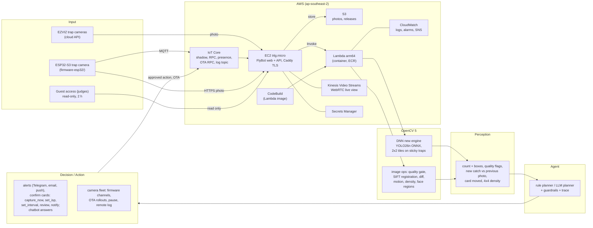

# FlyBot on AWS

FlyBot counts fruit flies on orchard traps from camera photos and helps growers act on it. Cameras (EZVIZ cloud
cameras and an open ESP32-S3 trap camera) send photos; an **OpenCV 5** pipeline on **AWS Lambda** detects and counts the
flies (YOLO26n on the OpenCV 5 DNN engine), checks the photo's quality and compares it with the previous one; a small
**agent** turns what it sees into proposals (take another photo, fix the camera's image settings, change the schedule,
ask a person to review, alert the grower) that FlyBot shows as confirm cards, and it answers grower questions in
FlyBot's chatbot. This repository is the OpenCV AI Competition 2026 entry: the vision Lambda, the agent, the AWS
infrastructure with a one-command deploy, the benchmark and the evaluation.

Live demo: **https://flybot.agrhub.com** (press **Guest access** on the sign-in page: a read-only demo account for two
hours; see "Try it")

## Submission documents (OpenCV AI Competition 2026)

| Document | What it holds |
|---|---|
| [docs/REPORT.md](docs/REPORT.md) ([PDF](docs/REPORT.pdf)) | technical report: problem, users, architecture, OpenCV 5, AWS, evaluation, COOL and Agentic Vision evidence, limitations, responsible use |
| [docs/diagrams/](docs/diagrams/) | [architecture](docs/diagrams/architecture.svg) (Input → OpenCV 5 → Perception → Agent → AWS → Decision/Action), [agent workflow](docs/diagrams/agent_workflow.svg), [trace example](docs/diagrams/trace_example.svg); PNGs beside them |
| [docs/evidence/agent/trace_example.json](docs/evidence/agent/trace_example.json) | a real perception → decision → action trace of the Lambda's handler on orchard photos |
| [eval/SYNTHETIC_RESULTS.md](eval/SYNTHETIC_RESULTS.md), [eval/SYNTHETIC_AGENT_EVAL.md](eval/SYNTHETIC_AGENT_EVAL.md) | SIMULATED data, kept apart from the real-photo `eval/RESULTS.md`: counts and tiled detection on synthetic photos with a known truth, and an automatic check of the agent on photos damaged on purpose |
| [docs/DEVPOST.md](docs/DEVPOST.md) | the Devpost submission text, with the COOL and Agentic Vision opt-ins |
| [docs/VIDEO_SCRIPT.md](docs/VIDEO_SCRIPT.md) | the demo video script (≤ 5 minutes) and its recording checklist |
| [docs/RESPONSIBLE_USE.md](docs/RESPONSIBLE_USE.md) | people in photos, human approval, security, data retention, bias |

## Architecture



| AWS service | What it does here |
|---|---|
| **Lambda** (arm64 container, 2 GB) | the OpenCV 5 vision pipeline + agent, one synchronous call per photo (`docs/CONTRACTS.md` section 1) |
| **S3** | photos (FlyBot's, and the simulated demo farm's), FlyBot releases and the Lambda build context; the Lambda stores no picture (FlyBot draws the boxes and blurs the face regions it returns) |
| **EC2** t4g.micro + Elastic IP | FlyBot (Node 22, prebuilt release from S3, systemd), Caddy (automatic TLS), MongoDB 7 unless you bring your own |
| **IoT Core** | the CamOS camera hub: device shadow (schedule, image settings, pause), RPC (capture, live, firmware update `ota.apply`, `log.start`), presence, the remote log topic `camos/<serial>/log`; one certificate per camera |
| **Kinesis Video Streams** | WebRTC live view of CamOS cameras, 15-minute viewer credentials per browser session |
| **CodeBuild** | builds the Lambda image (ARM) and pushes it to **ECR**; nothing is built on the server |
| **Secrets Manager** | every application secret (JWT, EZVIZ, SMTP, Telegram, MongoDB URI, storage keys, Google key) |
| **CloudWatch** + SNS | Lambda and build logs, alarms (Lambda errors and duration, EC2 status) by email |
| CloudFormation (SAM), IAM, SSM | one stack `flybot-<stage>` (`infra/template.yaml`), least-privilege roles, remote commands without SSH |

## Try it

Open https://flybot.agrhub.com/auth/login and press **Guest access** (under the sign-in button). No account or
email is needed: it opens a shared, read-only demo account for two hours. It shows:

- **Cameras** and **Dashboard**: the demo traps' latest photos, fly counts and trends (the density card filters by
  farm, status and trap kind);
- **Sentinel** (left menu): every analyzed photo with what OpenCV 5 saw and what the agent decided (traces), and the
  agent's proposals (view only);
- **Farms**, **Field map**, **Analytics**, **Reports** and the field log;
- the chatbot (bottom right): ask, for example, "how many flies on the traps this week?" (each guest session keeps
  its own conversation).

**Simulated demo farm (clearly labeled, not field data).** The real traps are new and have only a few weeks of
photos, so the guest account also shows a simulated farm network: 114 sticky and lure traps on 47 farms, in every
province of Vietnam and in a dozen fruit regions abroad (each with its main fruit fly), with plots, a field log and
a month of history. Every one is tagged **Simulated**: trap names start with "SIM ·", farms end with "(simulated)",
and a banner says so on every page. Its photos are synthetic trap pictures (a real empty trap photo with pasted fruit
flies, stamped SIMULATED), and each one went through the same OpenCV 5 Lambda as a real photo: the counts, boxes,
quality flags, traces and proposals are the pipeline's own. "Drawn: N" beside a count is the number of flies pasted
on the picture, to compare the detector on sticky and lure traps. The metrics in [eval/RESULTS.md](eval/RESULTS.md)
come from real photos only.

The guest account changes nothing: settings, captures, sharing, deleting and approvals are refused. Guest access and
the demo are the server's **Demo access** settings (Admin > System), on for the judging period. To try your own
ESP32-S3 camera, register an account and claim it at `/claim` (up to 3 cameras per account). If something does not
work, the contact form on the site reaches the operator.

## Deploy your own (one command)

Prerequisites: an AWS account where you can create IAM roles, the [AWS CLI v2](https://docs.aws.amazon.com/cli/latest/userguide/getting-started-install.html),
the [SAM CLI](https://docs.aws.amazon.com/serverless-application-model/latest/developerguide/install-sam-cli.html),
[uv](https://docs.astral.sh/uv/) or Python 3.9+, Node.js 22.12+ with npm, git, curl, and a checkout of the FlyBot app
(public, AGPL-3.0: the `flybot/` submodule or https://github.com/agrhub/flybot, branch `feat/aws`). No Docker anywhere: the server runs a prebuilt FlyBot release and the
Lambda image is built by CodeBuild.

```
cp deploy.env.example deploy.env      # once; fill it (table below). deploy.env is git-ignored
aws login --profile sentinel          # or any profile with admin rights in the target account
./deploy.sh                           # macOS / Linux / Git Bash;  Windows cmd or PowerShell: deploy.bat
```

The first run takes about 25 minutes (CloudFormation, the Lambda image on CodeBuild, the FlyBot build on your computer),
a re-run 3-5 minutes; it changes only what changed. It ends with a summary (URL, IP, release, detector, cost) and the
few things left for a person. The steps, all idempotent:

1. **preflight**: finds the tools (also off PATH), checks the AWS session (expired: prints the `aws login` command and
   exits with code 2), the region, that every AWS API it needs answers, the default VPC, the instance type, the Elastic IP
   and vCPU quotas, your FlyBot checkout (clean, Node 22), your bucket or S3-compatible storage if you named one;
2. **discover**: IoT endpoint, the newest Amazon Linux 2023 arm64 AMI (then kept), your public IP for the SSH rule, an
   SNS topic with a confirmed email to reuse, the existing stack and secrets;
3. **models**: the YOLO26n weights to the public model bucket (only when their sha256 changed);
4. **secrets**: `flybot-<stage>-app` / `-gcp` / `-anthropic` in Secrets Manager from deploy.env (JWT and web-push keys
   generated once), written only when the content changed; no value is ever printed;
5. **stack**: buckets, ECR, CodeBuild, IoT thing type and device policy, roles, the EC2 instance and its Elastic IP; the
   DNS record to add is printed right away in a box;
6. **flybot**: `npm ci` (when the lock file changed) and `npm run build` in your FlyBot checkout; a clean release tarball
   (about 17 MB, the home-page videos kept apart) published as a **GitHub pre-release** `flybot-<commit>` named
   "FlyBot <commit> (deploy build)" in `agrhub/flybot-aws`, with a `.sha256` asset (or to the private artifacts bucket
   with `FLYBOT_RELEASE_STORE=s3`, or when no `GITHUB_TOKEN` is set); the videos once to the artifacts bucket; then the
   release pointer the server follows (`flybot/current.json` in S3: a new release never restarts the instance).
   `--prune-releases` keeps the newest 5 deploy builds on GitHub;
7. **image** + **lambda**: the Lambda image on CodeBuild when its inputs changed (tag = hash of code and models), then the
   function and its alarms;
8. **bootstrap**: publishes `infra/host/bootstrap.sh` to the artifacts bucket and runs it through SSM (the EC2 user-data is
   only a stub that runs it, so changing the host logic never restarts the instance): Node 22, Caddy and (by default)
   MongoDB 7, the release downloaded anonymously from GitHub (or S3) and checked against its sha256, an atomic switch
   (the previous release is kept), the videos synced for Caddy, and the services restarted;
9. **health**, **smoke**, **coldstart**: FlyBot `/health` on the server, one DNS + HTTPS check (never a wait), one Lambda
   call with a sample photo checked against the contract, cold and warm latency into `bench/results/lambda_latency.json`.

Useful options: `--dry-run` (real checks, read-only, prints the plan), `--only <step>`, `--show-ip`, `--rollback` (back to
the previous FlyBot release), `--allow-dirty` (test release from uncommitted changes), `--npm-ci`, `--prune-releases`, `--yes` (allow deleting a
stack stuck in ROLLBACK_COMPLETE). Log: `infra/.build/deploy-<stage>.log`. Remove everything: `./destroy.sh --yes`
(`--keep-photos`, `--keep-secrets`; a bucket of your own is never touched). Step-by-step with expected output:
`infra/DEPLOY_CHECKLIST.md`.

### deploy.env

| Key | Default | Meaning |
|---|---|---|
| `STAGE` | `dev` | stack `flybot-<STAGE>`; every resource name carries it |
| `AWS_PROFILE`, `AWS_REGION` | `sentinel`, `ap-southeast-2` | CLI profile; the region is fixed (the account allows Sydney only) |
| `DOMAIN_NAME` | `flybot.agrhub.com` | the site; add the A record the script prints at your DNS provider |
| `ACME_EMAIL` | `ALARM_EMAIL` | Let's Encrypt contact |
| `ALARM_EMAIL` | reuse a confirmed topic | CloudWatch alarm email (a new address must click the SNS confirmation) |
| `OWNER_CIDR` | your public IP /32 | SSH source; SSH is optional (SSM is used) |
| `FLYBOT_SRC` | `../ezviz-manager` | your FlyBot checkout; built here, published as a release |
| `FLYBOT_RELEASE_STORE` | `github` | `github` (pre-release of `GITHUB_REPO`, downloaded anonymously by the server) or `s3` (artifacts bucket); `s3` is used when `GITHUB_TOKEN` is empty |
| `GITHUB_REPO` | `agrhub/flybot-aws` | the public repository that receives the deploy builds |
| `GITHUB_TOKEN` (secret, this computer only) | empty = `s3` | fine-grained token for `GITHUB_REPO`, Contents: read and write; never stored in AWS or sent to the server |
| `FLYBOT_KEEP_RELEASES` | 5 | deploy builds kept on GitHub by `--prune-releases` |
| `FLYBOT_MEDIA` | `separate` | `separate`: the videos (~190 MB) stay out of the release and are served by Caddy from a synced copy; `bundled`: inside every release |
| `VITE_GOOGLE_MAP_KEY` | empty | Google Maps browser key baked into the client |
| `MONGO_URI` (secret) | empty = MongoDB 7 on the server | an external database (e.g. MongoDB Atlas: allow the Elastic IP); a shared database also gets FlyBot's start-up migrations |
| `S3_BUCKET_NAME` | empty = a stack bucket | an existing AWS bucket (the roles get access; it is never deleted) or the bucket on `S3_ENDPOINT` |
| `S3_REGION` | looked up | the bucket's region (`auto` for S3-compatible services) |
| `S3_ENDPOINT` | empty | S3-compatible storage (MinIO, R2, ...), `https://` or `http://`, reachable from the internet: the Lambda then gets presigned URLs (an annotated picture, written only on request, goes to a stack bucket) |
| `S3_ACCESS_KEY`, `S3_SECRET_KEY` (secrets) | empty = the server's role | keys for `S3_ENDPOINT` |
| `DETECTOR` | `yolo26` | `yolo26` or `yolov7` (baseline) |
| `PLANNER_MODE` | `rule` | `rule` (deterministic) or `llm` (Anthropic per photo) for detect mode; deep mode uses the LLM when a key exists |
| `ANTHROPIC_SECRET_NAME`, `ANTHROPIC_API_KEY` (secret), `ANTHROPIC_MODEL` | `sentinel-dev-anthropic`, empty, `claude-haiku-5-5` | the LLM for deep-mode answers |
| `JWT_SECRET` (secret) | generated once | login tokens |
| `APP_KEY`, `SECRET_KEY` (secrets), `EZVIZ_DOMAIN` | empty | EZVIZ Open Platform app (EZVIZ cameras) |
| `TELEGRAM_BOT_TOKEN` (secret), `TELEGRAM_BOT_USERNAME` | empty = off | Telegram alerts |
| `SMTP_HOST`, `SMTP_PORT`, `SMTP_SECURE`, `SMTP_USER`, `SMTP_PASS` (secret), `MAIL_FROM`, `CONTACT_EMAIL` | empty = emails go to the server log | email verification, password reset, alerts |
| `VAPID_PUBLIC_KEY`, `VAPID_PRIVATE_KEY` (secret), `VAPID_SUBJECT` | generated once | web push |
| `APP_MODE` | `hybrid` | `b2c` personal workspaces, `b2b` organizations, `hybrid` both |
| `PAYMENTS_ENABLED`, `PAYMENTS_GRACE_DAYS`, `PAYMENTS_ALLOW_LIVE` | `false`, 7, `false` | online payment (never with `APP_MODE=b2b`); live Stripe keys on production only. Setup: `flybot/docs/payments.md` (FlyBot submodule) |
| `PAYOS_CLIENT_ID`, `PAYOS_API_KEY`, `PAYOS_CHECKSUM_KEY` (secrets), `PAYOS_API_URL`, `PAYOS_LINK_TTL_MINUTES` | empty, PayOS defaults | PayOS payment channel; webhook `https://<DOMAIN_NAME>/api/payments/webhooks/payos` |
| `STRIPE_SECRET_KEY`, `STRIPE_WEBHOOK_SECRET` (secrets), `STRIPE_API_URL`, `STRIPE_WEBHOOK_TOLERANCE` | empty, Stripe defaults, 300 s | Stripe; webhook `https://<DOMAIN_NAME>/api/payments/webhooks/stripe` |
| `GCP_SERVICE_ACCOUNT_FILE`, `VERTEX_PROJECT_ID`, `VERTEX_LOCATION`, `VERTEX_MODEL` | empty = chatbot off | Google service-account JSON (kept outside git) for the chatbot on Vertex AI |
| `DEMO_MAX_CAMERAS_PER_USER`, `DEMO_MAX_SNAPSHOTS_PER_DAY`, `DEMO_MAX_UNCLAIMED` | 3, 48, 200 | limits for self-registered cameras (`docs/CONTRACTS.md` 2a) |
| `INSTANCE_TYPE` | `t4g.micro` | changing it stops and starts the server (IP and disk stay) |
| `KEY_NAME`, `AMI_ID`, `NODE_VERSION`, `CADDY_VERSION`, `MODELS_BUCKET` | empty, pinned, newest 22.x, `2.10.2`, `sentinel-<account>-models-public` | advanced |
| `DEVICE_EVENTS_URL`, `DEVICE_EVENTS_SECRET` | empty | optional IoT rule webhook instead of FlyBot's MQTT subscriber |
| `SKIP_COLDSTART` | empty | `1` skips the latency measurement |

### Windows notes

- Run `deploy.bat` from cmd or PowerShell (same options). It uses Git for Windows' bash; set `GIT_BASH` if Git lives
  elsewhere. Without a `deploy.env` it copies the example and opens it in Notepad.
- Install the AWS CLI, SAM CLI, uv and Node from **your own terminal**, not from inside a sandboxed app: tools installed
  by an MSIX-packaged app under its virtualized `%APPDATA%` are invisible to your shell. The scripts look in the usual
  places (AWS CLI MSI per-user and all-users folders, `~/.local/bin`, `%APPDATA%\uv\tools`, nvm-windows `NVM_SYMLINK`
  and `D:\Tools\nvm-noinstall`, `C:\Program Files\nodejs`) and tell you what they tried.
- `python` may be the Microsoft Store stub; the scripts then use `uv run python`. AWS CLI output is forced to UTF-8.

## Run locally (no AWS account needed)

```
git clone https://github.com/agrhub/flybot-aws.git && cd flybot-aws
make setup                 # uv sync in lambda/vision (OpenCV 5.0.0, numpy, pydantic, anthropic; no torch)
make models                # YOLOv7-tiny baseline ONNX (24 MB, SHA-256 checked) into models/yolov7-tiny/
make test                  # the vision ops on real trap fixtures, the agent and its guardrails, the Lambda contract (~2-5 min)
make replay-sample         # 24 real lure-trap photos through the Lambda handler -> data/replay/sample/
make lambda-local          # POST http://localhost:9001/invoke, the same JSON as Lambda.Invoke; GET /health
```

Without `make` (Windows): `cd lambda/vision && uv sync --group dev && uv run pytest -q`, and
`uv run python -m sentinel.lambda_local`. YOLO26n instead of the baseline: download
`https://sentinel-685527430355-models-public.s3.ap-southeast-2.amazonaws.com/models/yolo26/fruitfly_yolo26n.onnx`
(and `.onnx.json`) into `models/yolo26/` (sha256 `fb4da5c0...f176`, `models/MODEL_CARD.md`) and set `DETECTOR=yolo26`.

A request by hand:

```
curl -s localhost:9001/invoke -d '{"v":1,"mode":"detect","photo":{"url":"file:///ABS/PATH/flybot-aws/data/samples/images/BE4089629/6ac327d44c3227d11cfbd084.jpg"},"camera":{"id":"BE4089629","trapKind":"lure"},"capturedAt":"2026-10-05T04:30:12Z","locale":"en"}'
```

Deep mode (`"mode":"deep","question":"Why did the count jump today?"`) answers in markdown through the LLM planner when
`ANTHROPIC_API_KEY` is set (`.env.example`); without a key it answers from the rule planner with a template. FlyBot itself
(web app, chatbot, cameras) runs locally with `docker compose up -d --build mongo flybot` (needs the FlyBot submodule).

## Results

| What | Number | Source |
|---|---|---|
| YOLO26n on OpenCV 5 DNN, Roboflow test split (76 images, 2,349 flies) | mAP@50 0.953, mAP@50-95 0.700, P/R 0.913/0.898 | `models/MODEL_CARD.md`, `eval/results/yolo26n_test_metrics.json` |
| OpenCV 5 DNN vs ONNX Runtime | identical detections on 20 test images and 20 trap photos | `eval/results/yolo26n_opencv_parity_colab.json`, `eval/results/yolo26_parity.json` |
| YOLOv7-tiny baseline vs the production count, 1,293 real photos | MAE 0.84 flies | `eval/RESULTS.md` 1b |
| Lambda latency (arm64, 2 GB, sample photo pair) | warm p50 980 ms | `bench/results/lambda_latency.json` |
| SIMULATED: tiled detection on synthetic sticky cards (whole handler, 129 clean photos) | recall 0.07 → 0.82, MAE 36.7 → 5.0 flies; lure unchanged | `eval/SYNTHETIC_RESULTS.md` |
| SIMULATED: agent on 147 synthetic photos damaged on purpose (automatic check, not an expert review) | the policy's action on 111 | `eval/SYNTHETIC_AGENT_EVAL.md` |
| Human ground truth | 0 count labels, 0/50 expert verdicts: not measured | `eval/GROUND_TRUTH.md`, `eval/results/expert_review.json` |
| COOL (Graviton4 AMI) vs pip OpenCV 5 on the same pipeline, 500 photo pairs x 5 | COOL 4.6 % slower per photo; cheapest: x86 c7i, USD 0.0155 per 1,000 photos | `bench/REPORT_COOL.md` |
| Marginal cost on Lambda | ~USD 0.046 per 1,000 photos | `infra/COST.md` |

Reproduce:
- Evaluation: `eval/RESULTS.md` was rendered by `eval/run_eval.py` from the result files in `eval/results/` (each table
  names its file). A rerun needs the Roboflow dataset (public, CC BY 4.0, `models/dataset.md`) and FlyBot's photo
  export (production data, not public); the replay and live-trace sections also depend on modules of the earlier
  queue-based pipeline that are not in this repository. The detection numbers of YOLO26n are reproduced by
  `models/colab_train_yolo26.ipynb` and `models/verify_yolo26.py`; the Lambda path by `make replay-sample`.
- COOL benchmark: `bash bench/run_matrix.sh --dry-run`, then `--only b,c` and `--only cool` (`bench/REPORT_COOL.md`
  section 7). It launches EC2 instances in your account and terminates them itself; the 500 photo pairs it uses come from
  the production export, so outside AGRHUB's account pass your own `--bucket` with inputs.
- Model: `models/colab_train_yolo26.ipynb` and `models/COLAB_RUNBOOK.md` (Colab T4, about 25 minutes).

## Costs

About **17 USD per month** for the demo (t4g.micro, its public IPv4 and disk are 85 % of it) and **~0.046 USD per 1,000
photos** on Lambda. Details and sources: `infra/COST.md`.

## Security and responsible use

- Secrets live in Secrets Manager only; the server's environment file holds names and ARNs, never a secret value. The
  scripts never print secret values, and the pre-commit check (`make hooks`, `infra/ops/secrets-scan.sh --staged`)
  refuses `deploy.env`, key files and secret-looking lines. The GitHub token used to publish FlyBot releases stays on
  the deploying computer; the server downloads public release assets anonymously and checks their sha256.
- Least-privilege IAM: the server reads only its release pointer, host script and videos, its photo bucket, invokes only its Lambda, manages only
  `camos-camera` things and their certificates, and hands browsers 15-minute KVS viewer credentials scoped to one
  channel. Each camera certificate can only use its own MQTT topics. IMDSv2 is required; no SSH key is needed.
- People and privacy: the LLM planner receives the pipeline's numbers and flags as text, never a photo. The Lambda
  stores no picture; when it suspects a person it returns the face regions, which FlyBot's Sentinel console blurs.
  Camera logs leave the camera with passwords and codes removed.
- Guests: the guest account is read-only and ends after two hours; the simulated demo farm is labelled on every item and
  never enters reports, alerts or `eval/RESULTS.md`.
- People decide: the agent proposes, a person confirms camera changes and schedule changes in FlyBot; guardrails cap
  extra captures per camera and day.
- Self-registered demo cameras are limited (cameras per user, photos per day, unclaimed devices; `docs/CONTRACTS.md` 2a).

## Limits

- One region (Sydney), one server: no high availability; MongoDB on the server is backed up only with its EBS volume
  (snapshots are not configured), or use `MONGO_URI`.
- Detection accuracy is measured on the Roboflow test split; counts on the orchard traps are compared with the production
  model, not with human counts (none labeled yet, `eval/RESULTS.md`). The demo traps were mostly empty in October 2026.
- The DNS record is added by hand at the registrar; Caddy gets the certificate once it resolves.
- S3-compatible storage must be reachable from AWS (the Lambda fetches presigned URLs).
- Sticky-card counting and tiled detection are measured on synthetic cards only (`eval/SYNTHETIC_RESULTS.md`); the
  tiled detector's latency on Lambda is not measured.

## Repository

| Part | Path | Access |
|---|---|---|
| Vision Lambda + agent (Python 3.12, OpenCV 5) | `lambda/vision/` | this repo, AGPL-3.0 |
| Infrastructure: SAM template, `deploy.sh`, `destroy.sh` | `infra/`, `deploy.env.example` | this repo |
| Benchmark, evaluation, model training | `bench/`, `eval/`, `models/` | this repo |
| Contracts between the parts, design decisions | `docs/CONTRACTS.md`, `docs/DECISIONS.md` | this repo |
| Evidence cited by the reports (vision checks, failure injection, expert review sheet, benchmark build info) | `docs/evidence/` | this repo; `python infra/ops/check-links.py` checks every cited file exists |
| ESP32-S3 trap camera firmware | `firmware-esp32/` (agrhub/camos-esp32-trap) | public submodule, AGPL-3.0 |
| FlyBot web app (API, Vue client, chatbot, camera platforms) | `flybot/` (agrhub/flybot, branch `feat/aws`) | public submodule, AGPL-3.0 |
| AMB82 camera firmware, production datasets, production model weights | not published | |

`git clone --recurse-submodules https://github.com/agrhub/flybot-aws.git` fetches both submodules. Everything in "Run
locally" works without the FlyBot app. Deploying needs a FlyBot checkout on your computer (`FLYBOT_SRC`, for example the
`flybot/` submodule); the server never needs GitHub access.

License: AGPL-3.0 (LICENSE, NOTICE); the YOLO26n weights derive from Ultralytics YOLO26 (AGPL-3.0). FlyBot
(`flybot/`, AGPL-3.0-only from the release after 1.5.0) and the camera firmware (`firmware-esp32/`, AGPL-3.0) carry
their own LICENSE files. Dataset: camos fruit-fly dataset on Roboflow Universe, CC BY 4.0.
