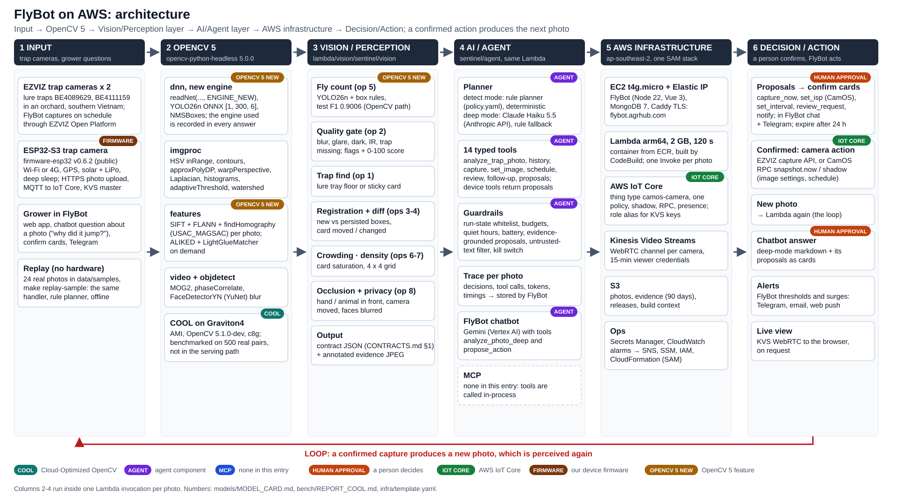
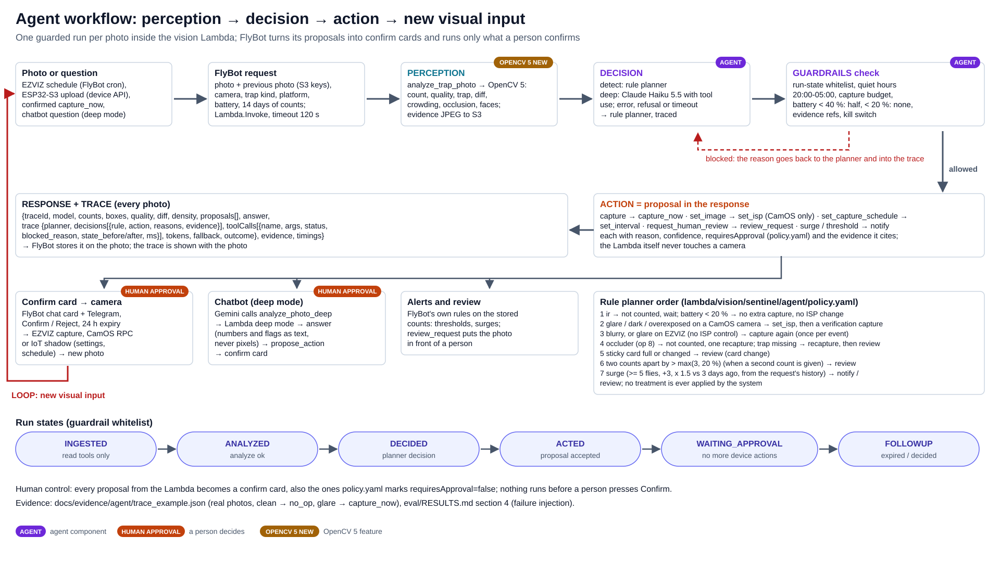
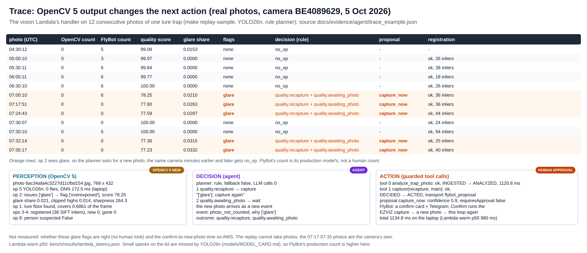

# FlyBot on AWS: technical report

**Fruit-fly trap monitoring that looks before it counts: OpenCV 5 and a guarded agent on AWS.** OpenCV AI Competition
2026, powered by AWS. Team: AGRHUB, makers of FlyBot. State of the system: 20 October 2026.

- Live app: https://flybot.agrhub.com (FlyBot on EC2, vision on Lambda, cameras on IoT Core and Kinesis Video Streams).
  Judges: press **Guest access** on the sign-in page for a read-only demo account (two hours, section 3.2).
- Code: this repository, [agrhub/flybot-aws](https://github.com/agrhub/flybot-aws) (vision Lambda, agent,
  infrastructure, benchmark, evaluation), with two public submodules: the FlyBot app
  ([agrhub/flybot](https://github.com/agrhub/flybot), branch `feat/aws`) and the ESP32-S3 trap camera firmware
  ([agrhub/camos-esp32-trap](https://github.com/agrhub/camos-esp32-trap), v0.9.1). All three are AGPL-3.0.
- Diagrams: [architecture](diagrams/architecture.svg), [agent workflow](diagrams/agent_workflow.svg),
  [trace example](diagrams/trace_example.svg). Companion texts: [SYSTEM_ARCHITECTURE.md](SYSTEM_ARCHITECTURE.md), [SYSTEM_REQUIREMENTS.md](SYSTEM_REQUIREMENTS.md), [slides](SLIDES.pdf), [DEVPOST.md](DEVPOST.md),
  [VIDEO_SCRIPT.md](VIDEO_SCRIPT.md), [RESPONSIBLE_USE.md](RESPONSIBLE_USE.md).

Rule for this report: every number names the file it comes from (under `eval/`, `bench/`, `models/`, `infra/` or
`docs/evidence/`). "Not measured" means nobody measured it.

## 1. Problem

Fruit growers in Vietnam watch the oriental fruit fly (*Bactrocera* spp.) with lure traps and yellow sticky cards and
decide from the counts when to act. FlyBot, AGRHUB's app, photographs the traps with cameras and counts the flies with
a detector. A count alone has three blind spots:

- **Every photo is counted as it comes.** Glare, blur, a dark or infrared frame, a hand in front of the trap or a camera
  that no longer sees the trap all produce a number. One camera in FlyBot's data filmed a building facade instead of
  a trap, and every count it produced was a false positive; it is now excluded everywhere
  (`data/excluded_cameras.csv`).
- **A count is not a catch.** In a trap the flies stay; the useful signal is what changed since the previous photo,
  which needs the two photos registered.
- **The camera never reacts.** Captures follow a fixed schedule; nothing asks for a better photo, changes the camera's
  exposure or schedule, or puts a doubtful photo in front of a person.

FlyBot on AWS adds the missing loop. **OpenCV 5 perceives** each photo (count, quality, trap, change, occlusion,
faces), **an agent decides** what should happen next under guardrails, and **FlyBot acts** once a person confirms:
it takes a new photo, changes the camera's image settings or schedule, or asks for a review. The new photo starts the
next loop.

## 2. Target users

Growers and farm managers who run FlyBot traps, and the agronomists who advise them. They use FlyBot's web app (in
Vietnamese or English), its chatbot, and Telegram. The system serves two camera families: EZVIZ cloud cameras that
farms already own, and an open, low-cost ESP32-S3 trap camera (solar, Wi-Fi or 4G, GPS) whose firmware and parts
list are public. The field camera as built, in a hanging solar trap housing with an ESP32-S3 N16R8 board, an OV5640 wide-angle camera,
4G, GPS, a flat LiPo cell and a 5 V boost board, costs about US$39 in all (944,760 VND of parts at 26,050 VND/USD, the
Vietcombank rate on 21 Oct 2026, plus the US$3.00 housing); a Wi-Fi camera in the same housing is about US$19 (the
reference field build of the wiring page, in an IP65 box: about US$60)
([parts list](https://github.com/agrhub/camos-esp32-trap/blob/main/docs/BOM.md), prices read on 17, 24 and 25 Oct 2026).

**Agronomy advisor.** MSc Trương Quốc Ánh, Principal Researcher and Deputy Head of the Biotechnology Department, Institute of Agricultural Science for Southern Vietnam (IAS, under VAAS), Ho Chi Minh City; research in plant breeding genetics, plant biotechnology and DNA barcoding, and applied projects on smart agriculture and IoT for pest control (https://iasvn.org/bo-mon-cong-nghe-sinh-hoc/). He is not a team member. On 21 Oct 2026 he reviewed 50 of the agent's decisions (section 6.7).

The demo traps are two EZVIZ lure-trap cameras in an orchard in southern Vietnam (`data/samples/README.md`). They are
new and caught few flies in October, so the guest account also shows a clearly labelled simulated farm network
(section 3.2); it is a demonstration, never field evidence. Number of real farms, users and hours of counting saved:
**not measured**.

## 3. Architecture



*Figure 1. `docs/diagrams/architecture.svg` (built by `docs/diagrams/src/build_diagrams.py`). Markers: COOL, AGENT,
MCP (none in this entry), HUMAN APPROVAL, IOT CORE, FIRMWARE, OPENCV 5 NEW.*

1. **Input.** FlyBot captures the EZVIZ cameras on schedule through the EZVIZ Open Platform and stores each photo in
   S3. The ESP32-S3 trap camera uploads its photos over HTTPS to FlyBot's device API and talks MQTT to AWS IoT Core
   (`docs/CONTRACTS.md` sections 2-3). A grower can also ask FlyBot's chatbot about a photo, and a judge can open the
   read-only guest account (section 3.2). Without hardware, the 24 bundled photos in `data/samples/` go through the
   same handler (`make replay-sample`).
2. **OpenCV 5.** `opencv-python-headless==5.0.0.93` (`lambda/vision/requirements-lambda.txt`) in a Python 3.12 arm64
   Lambda container; `sentinel.require_opencv5()` refuses any 4.x build. The COOL build (OpenCV 5.1.0-dev) ran the
   benchmark on a Graviton4 instance (section 7).
3. **Vision/Perception.** `lambda/vision/sentinel/vision/` runs the ops of section 4 once per photo, together with the
   previous photo of the same camera, and returns JSON. It stores no picture: FlyBot draws the returned boxes on its
   own photo and blurs the face regions the Lambda returns (`privacy.regions`, `docs/CONTRACTS.md` section 1a).
4. **AI/Agent.** `lambda/vision/sentinel/agent/`, in the same invocation: a deterministic rule planner for every photo
   (`detect` mode) and a Claude Haiku 5.5 planner for grower questions (`deep` mode), 14 typed tools, guardrails and a
   trace. FlyBot's own chatbot (Gemini on Vertex AI) reaches the agent through two tools, `analyze_photo_deep` and
   `propose_action` ([sentinelTools.js](https://github.com/agrhub/flybot/blob/feat/aws/server/src/agent/tools/sentinelTools.js)).
5. **AWS infrastructure.** One SAM stack in ap-southeast-2 (`infra/template.yaml`), section 5.
6. **Decision/Action.** The Lambda never touches a camera: every action it accepts comes back as a **proposal**
   (`capture_now`, `set_isp`, `set_interval`, `review_request`, `notify`), with its reason in Vietnamese and English
   (`reasonI18n`). FlyBot shows each one as a confirm card in the owner's chat panel and on Telegram, in the reader's
   language; only a person's **Confirm** runs it (an EZVIZ capture, an IoT Core RPC, or
   a device-shadow change), and an unanswered card expires after 24 hours
   ([sentinelService.js](https://github.com/agrhub/flybot/blob/feat/aws/server/src/services/sentinelService.js)
   `createLambdaProposals`). This is the **human-approval** step. A confirmed capture produces a new photo, which goes
   through the loop again.

The contract between FlyBot and the Lambda is one synchronous `Lambda.Invoke` per photo: photo and previous photo by
S3 key, camera, trap kind, platform, battery, 14 days of counts; response with counts, boxes, quality, diff, density,
proposals, trace, privacy and timings (`docs/CONTRACTS.md` section 1). The Lambda is stateless: FlyBot (MongoDB) owns
cameras, photos, cards and traces (`docs/DECISIONS.md`).

### 3.1 Cameras, live view and the camera fleet

| Camera | Path into FlyBot | What FlyBot can change | Live view |
|---|---|---|---|
| EZVIZ (2 in the orchard, lure traps) | FlyBot's schedule, EZVIZ Open Platform | extra capture, capture interval | EZVIZ's own player |
| ESP32-S3 trap camera, firmware v0.9.1 | HTTPS photo upload (device token) + MQTT over mutual TLS to IoT Core | shadow: capture interval, image settings, live request; RPC: `snapshot.now`, `live.start`, `gps.fix`, `ota.apply`, `log.start` (`docs/CONTRACTS.md` section 3) | KVS WebRTC: the camera is the master, the browser the viewer |

Zero-touch registration: the camera generates its own key, FlyBot signs its CSR through IoT Core, creates the thing
and its KVS channel, and the owner claims it by QR code or serial and verify code (`docs/CONTRACTS.md` section 2a).
Each certificate can use only its own topics; the camera gets KVS master credentials through an IoT role alias, and
each browser gets 15-minute viewer credentials for one channel (`docs/DECISIONS.md`, "Cameras and live view").
Measured on the bench board over Wi-Fi with a viewer on the same network: JPEG 640x480 at 14.8-15.3 fps in a dark room
(17 Oct) and 8.6-11.1 fps in a lit room (18 Oct); the 4G uplink and a remote viewer through a TURN relay are **not
measured** ([LIVE_VIEW.md](https://github.com/agrhub/camos-esp32-trap/blob/main/docs/dev/LIVE_VIEW.md)). Firmware 0.6.3 turned the OV5640's night mode off by default
for streams (it had stretched each frame to four frame times even in room light) and switched "auto" white balance to
the sensor's simple AWB: under LED room light, live JPEG 640x480 went from 2.1 to 5.4 fps
([WEB_CONSOLE.md](https://github.com/agrhub/camos-esp32-trap/blob/main/docs/WEB_CONSOLE.md), 19 Oct). Battery
currents are **not measured**; the power budget is an estimate
([POWER_BUDGET.md](https://github.com/agrhub/camos-esp32-trap/blob/main/docs/dev/POWER_BUDGET.md)).

**Camera fleet** (FlyBot Admin; administrators act, support accounts only read). A serial registry (one by one, from a
CSV file or from the label QR text); firmware releases imported from the camos-esp32-trap GitHub releases and checked
against their `SHA256SUMS`, on alpha, beta and stable channels (a camera takes the newest release of its channel or of
a more stable one); rollouts to chosen serials or to every camera of a model, with each camera's progress and result;
a pause that stops a camera's photos, uploads and live view. An update is the RPC `ota.apply` over IoT Core (no IoT
Jobs): the camera fetches the image from a one-hour signed link and reports `ota_progress` and `ota_result`. A battery
guard holds the update below 40 % (or 3,700 mV when the camera reports no percentage) unless the camera is on mains or
charging ([firmwareService.js](https://github.com/agrhub/flybot/blob/feat/aws/server/src/services/firmwareService.js), [CHANGELOG.md](https://github.com/agrhub/flybot/blob/feat/aws/CHANGELOG.md) 1.6.0).

**Remote console log and crash reports** (firmware 0.8.0). A camera's owner or an administrator turns on its console
log for up to an hour; the camera sends batches on `camos/<serial>/log` (allowed by the device policy and forwarded by
the optional topic rule, `infra/iot/camera-policy.json`, `infra/template.yaml`), with passwords and codes replaced by
`***` on the camera; FlyBot keeps 24 hours. After a crash, a watchdog or a brownout reset, the camera reports the
reason, its last log lines and, when installed with the 0.8.0 image, a coredump summary (task, PC, backtrace) from a new
`coredump` partition. Over OTA on the older partition table 0.8.0 stays safe: app, OTA data and NVS offsets do not
move, later updates work, and crash reports come without the coredump (checked on the board on 19 Oct,
[PROTOCOL_ADDITIONS.md](https://github.com/agrhub/camos-esp32-trap/blob/main/docs/dev/PROTOCOL_ADDITIONS.md) section 11).

### 3.2 Guest access and the simulated demo farm

A **Guest access** button on the sign-in page opens one shared, read-only demo account for two hours (the session is
never extended; turning the switch off in Admin > System > Demo access ends it at once; 20 sessions per hour per IP).
The server refuses every write request from it except chatbot messages and sign-out, so settings, captures, sharing,
deleting and approvals are refused; each guest session keeps its own chatbot conversation; guests read the Sentinel
console (traces and proposals) but cannot decide on a proposal
([guestAccess.js](https://github.com/agrhub/flybot/blob/feat/aws/server/src/services/guestAccess.js), [guestAccess.test.js](https://github.com/agrhub/flybot/blob/feat/aws/server/tests/guestAccess.test.js)).

The guest account shows the two real EZVIZ traps and a **simulated farm network**: 114 sticky and lure traps on 47
farms, in every province of Vietnam and in a dozen fruit regions abroad, with English names, plots, a field log and a
month of history ([DEPLOY.md](https://github.com/agrhub/flybot/blob/feat/aws/DEPLOY.md), "Demo access and the simulated demo farm"). Its photos are the labelled
synthetic trap pictures of `eval/synth` (a real empty-trap photo, or a synthetic sticky card, with pasted flies and a
visible SIMULATED stamp); the seed run sends 2,852 of them through the real vision Lambda (same file) and a daily job
adds more, so the counts, boxes, flags, traces and proposals are the pipeline's own. Every item is marked: "SIM ·" trap
names, "(simulated)" farm names, a banner on every page, a line in exported PDFs, and the number of flies drawn
("Drawn: N") beside the AI's count; simulated data never enters emailed reports, alerts or webhooks. **It is not field
evidence:** `eval/RESULTS.md` holds real photos only; the synthetic measurements are in section 6.8.

## 4. OpenCV 5 implementation

Every op returns a JSON-serializable dict with an `evidence` field. Timings marked *c8g* are per-op p50 on Graviton4
with the pip wheel inside the full per-photo call on 500 real photo pairs (`bench/REPORT_COOL.md`, with the earlier
YOLOv7-tiny detector); *laptop* timings are from a shared 4-core laptop and are not benchmarks.

| # | Op (file in `lambda/vision/sentinel/vision/`) | OpenCV 5 modules and calls | Measured (source) |
|---|---|---|---|
| 5 | Fly count (`detect_yolo26.py`, `box_rules.py`, `detector.py`) | **dnn, new engine**: `readNet(..., ENGINE_NEW)` on the YOLO26n ONNX (`[1, 300, 6]`, no NMS in the graph), letterbox 640, `NMSBoxes` (IoU 0.45), fruit-fly box rules (score, size, aspect, median size); the engine actually used is recorded. **Tiled on sticky traps** (`tiling.py`, `DETECTOR_TILES=sticky` in production): 2 x 2 windows with 12 % overlap, boxes cut by an inner window edge dropped, NMS and box rules in full-frame pixels. **Counted only on the trap surface** (`regions.py`, `DETECTOR_ROI=all` in production): op 1 runs first and boxes off the lure floor or the sticky card are dropped | Roboflow test split, OpenCV path: precision 0.9025, recall 0.8987, F1 0.9006 (`models/MODEL_CARD.md`, `eval/results/yolo26_box_rules.json`). Same detections as ONNX Runtime on 20 test images and 20 trap photos (`eval/results/yolo26n_opencv_parity_colab.json`, `eval/results/yolo26_parity.json`). DNN p50 116.0 ms (laptop, `eval/results/replay_sample_yolo26.json`). Tiles on the synthetic sticky card (simulated), whole handler: recall 0.0687 → 0.8165, MAE 36.7 → 5.0 flies, lure unchanged; `detect()` p50 128.4 → 510.4 ms on a laptop, on Lambda **not measured** (`eval/SYNTHETIC_RESULTS.md`, `eval/results/synth_tiles.json`). Trap-surface filter, whole handler on demo-30d (simulated): sticky precision 0.849 → 0.987, lure 0.9785 → 0.987, recall unchanged; 320 real empty EZVIZ lure photos 5 → 3 false flies (detector step, `eval/results/detector_ab.json`) |
| 2 | Quality gate (`quality.py`, `quality_thresholds.yaml`) | `Laplacian` variance, histogram clipping, specular mask, `boxFilter` flat patches, IR detection, per-camera baseline | Agreement with FlyBot's own quality flags 0.903 on 3,000 photos, 0.914 on 537 (`docs/evidence/vision/quality_calibration.json`); 0 of 42 clean photos flagged (`eval/RESULTS.md` section 4); glare on a lure tray floor judged at 5 % of the floor since the advisor's review (sticky card 2 %): glare flags on the 1,293-photo export 91 → 41, on the 24 bundled photos 10 → 4 (`eval/results/glare_rule_ab.json`); 4.8 ms (c8g) |
| 1 | Trap find (`card.py`, `card_check.py`) | `cvtColor` HSV, `inRange`, `morphologyEx`, `findContours`, `approxPolyDP`, `fitLine`, `convexHull`, `getPerspectiveTransform`, `warpPerspective` | Lure tray floor found 50/50, held-out quad 45/50 (`docs/evidence/vision/card_check_lure/results.json`, `holdout_results.json`); sticky card on synthetic composites: hit rate 0.975, corner error p50 1.83 px (`docs/evidence/vision/card_synth.json`); no real sticky-card photo exists (`docs/evidence/vision/card_check.md`); 28.4 ms (c8g) |
| 3 | Registration with the previous photo (`register.py`) | **features**: `SIFT_create` + `FlannBasedMatcher` + `findHomography(USAC_MAGSAC)` per photo; `ALIKED_create` + `LightGlueMatcher_create` (new in OpenCV 5) on demand | 6 real pairs: inliers p50 348.5 (ALIKED + LightGlue) vs 105.5 (SIFT) at 5,749 vs 174 ms per pair, laptop (`docs/evidence/vision/diff_eval.json`); SIFT 69.2 ms (c8g) |
| 4 | Change since the previous photo (`diff.py`) | `perspectiveTransform` of the boxes, Hungarian matching, `absdiff` heat map, `applyColorMap` | Card-change recall 1.0 on the single real event with interim boxes (129 false flags), 0.0 with YOLOv7 boxes (7 false flags) (`docs/evidence/vision/diff_eval.json`, `eval/results/diff_with_yolo_boxes.json`); new-catch accuracy **not measured** (no labels); 2.6 ms (c8g) |
| 6 | Crowding on sticky cards (`crowd.py`) | `adaptiveThreshold`, `distanceTransform`, `watershed`, `connectedComponentsWithStats` | Pearson r 0.931 (test) / 0.987 (valid) blob count vs labels, white-disc pictures (`docs/evidence/vision/crowd_eval.json`, `crowd_eval_valid.json`) |
| 7 | Density (`density.py`, handler 4 x 4 grid) | grid counts; orchard map: IDW, `inpaint`, `GaussianBlur`, `applyColorMap` | Validation **not measured** (synthetic layouts only, `docs/evidence/vision/density/density_synthetic.json`) |
| 8 | Occlusion, camera moved, privacy (`motion.py`) | illumination-normalized ratio difference, `createBackgroundSubtractorMOG2`, `phaseCorrelate`, `FaceDetectorYN` (YuNet): face regions returned for FlyBot to blur | Synthetic occluders: recall 0.94; camera moved: recall 1.0; 0/200 false occluder flags on real pairs (`docs/evidence/vision/motion_eval.json`); face detection accuracy **not measured** (no photo with a person); 91.5 ms (c8g) |
| - | Whole call on Lambda | decode both photos, ops 1-6 and 8, agent | Warm p50 980 ms over 5 calls, cold 3,633 ms + 133 ms init, 2,048 MB arm64, max memory 426 MB, on a lure pair on 20 Oct (whole-frame detection on lure traps; the Lambda stores no picture) (`bench/results/lambda_latency.json`); a synthetic sticky card with 2 x 2 tiles: handler p50 1,007 ms, DNN 851 ms (`bench/results/lambda_latency_sticky_tiles.json`) |

### What we learned about OpenCV 5

- **New DNN engine.** The detector passes `cv2.dnn.ENGINE_NEW` and records the engine actually used, because
  `ENGINE_AUTO` can fall back to the classic engine silently and `OPENCV_FORCE_DNN_ENGINE` overrides the argument
  (`lambda/vision/Dockerfile`). YOLO26n's end-to-end head still leaves duplicate boxes, so the Lambda applies
  class-agnostic NMS and fruit-fly box rules; on the held-out test split that raised F1 from 0.8788 to 0.9006 and on
  the 24 bundled orchard photos it removed 15 false flies (the trap's lens) (`models/MODEL_CARD.md`). The engines
  agree on detections but order tied low-score rows differently, so parity is checked on detections, not raw rows
  (same file).
- **Small objects.** Letterboxing a 2304x1296 frame to 640 leaves sticky-card flies at 16-20 px, where YOLO26n's
  recall is 0.009, against 0.8628 above 28 px (synthetic sets, `eval/SYNTHETIC_RESULTS.md`). Running the same network
  on 2 x 2 tiles of the frame fixed this without retraining, at four forwards per sticky photo.
- **Boxes off the trap.** Logos, housings and walls produce confident false boxes. Counting only boxes on the
  surface op 1 finds (`DETECTOR_ROI`) raised sticky precision from 0.849 to 0.987 on the simulated trap without
  touching recall; an overlay mask added nothing on top, and no score floor other than 0.35 keeps the public test
  split's precision and recall (`eval/results/detector_ab.json`).
- **New features module.** ALIKED + LightGlue gives 3.3x the inliers of SIFT at 33x the time on CPU
  (`docs/evidence/vision/diff_eval.json`), so SIFT stays the per-photo default and ALIKED + LightGlue is the on-demand
  method.
- **Arm.** The pip arm64 wheel already contains KleidiCV; on Graviton4 it matches an x86 Sapphire Rapids instance on
  the image ops but is slower on the DNN forward (section 7).

The VLM inside OpenCV 5 is **not used**.

## 5. AWS deployment

Everything runs in ap-southeast-2 as one SAM stack `flybot-<stage>` (`infra/template.yaml`), created and updated by
`./deploy.sh` with one settings file (`deploy.env.example`); `./destroy.sh` removes it. Steps and checks:
README "Deploy your own", `infra/DEPLOY_CHECKLIST.md`.

| AWS service | Role here (`infra/template.yaml`) |
|---|---|
| **Lambda** (container, arm64, 2,048 MB, 120 s) | `flybot-vision-<stage>`: the OpenCV 5 pipeline and the agent, one synchronous call per photo |
| **ECR** + **CodeBuild** | the Lambda image, built on ARM by CodeBuild and tagged with a hash of its inputs; nothing is built on the server |
| **EC2** t4g.micro + Elastic IP | FlyBot (Node 22 API + Vue 3 client) as a prebuilt release, MongoDB 7, Caddy with automatic TLS for flybot.agrhub.com |
| **IoT Core** | thing type `camos-camera`, one device policy with per-thing topics, device shadow, RPC (also `ota.apply` for firmware updates and `log.start`), presence, the remote log topic `camos/<serial>/log`; optional topic rules to FlyBot; role alias for KVS credentials |
| **Kinesis Video Streams** | one WebRTC signaling channel per CamOS camera (created by FlyBot), viewer role limited to one channel for 15 minutes |
| **S3** | photos (FlyBot's, and the simulated farm's under `simulated/`), FlyBot releases, the Lambda build context; the Lambda stores no picture (an annotated JPEG only on request, e.g. the benchmark) |
| **Secrets Manager** | every application secret (JWT, EZVIZ, SMTP, Telegram, MongoDB URI, Anthropic key, Google key) |
| **CloudWatch** + **SNS** | logs, alarms on Lambda errors, Lambda duration and EC2 status, by email |
| IAM, SSM, CloudFormation | least-privilege roles, remote commands without SSH, the stack |

**Cost.** About 17 USD per month for the demo (the t4g.micro, its public IPv4 and its disk are 85 % of it) and about
0.046 USD per 1,000 photos on Lambda (`infra/COST.md`). The Anthropic API (deep mode) and Vertex AI (FlyBot's chatbot)
are billed outside AWS and are not in these numbers.

**Observability.** Every Lambda answer carries a trace (planner, decisions, tool calls with status and timing, LLM
tokens, fallback, outcome) that FlyBot stores with the photo; CloudWatch keeps the Lambda and build logs and raises the
alarms; `./deploy.sh` ends with a health check, one contract call with a sample photo and a cold/warm latency
measurement (`bench/results/lambda_latency.json`).

**Security.** No secret in git or on the server's disk: FlyBot reads Secrets Manager at start-up with the instance role,
and `infra/ops/secrets-scan.sh` checks every commit. IMDSv2 is required and SSH is optional. The instance role invokes
only its Lambda, reads only its buckets, and manages only `camos-camera` things and their certificates; browsers never
see the server's credentials (`docs/DECISIONS.md`, "Infrastructure" and "Cameras and live view").

## 6. Evaluation

Two builds share the vision and agent package. The **current build** (YOLO26n, stateless Lambda behind FlyBot) is
measured by the detector tests, the Lambda latency and the 24-photo replay. The **earlier build** (15 Oct, YOLOv7-tiny,
a queue-based stack that has since been removed) produced the scenario suite, the failure injection, the 30-day replays
and the first live traces in `eval/RESULTS.md`; those runs exercise the same planner, guardrails and vision ops, with
the earlier detector and with fake devices. Section 6.8 is **simulated**: synthetic photos with a known truth, kept
apart from the real-photo results. Each number below says which build and which data it comes from.

### 6.1 Detection (current build)

| Data | n | Result | Source |
|---|---|---|---|
| Roboflow test split, camos/fruit-fly-wmcqi v3 (CC BY 4.0), Ultralytics validation | 76 images, 2,349 flies | mAP@50 0.953, mAP@50-95 0.700, P/R 0.913 / 0.898 (YOLOv7-tiny: 0.958, 0.67, 0.928 / 0.908) | `eval/results/yolo26n_test_metrics.json`, `models/MODEL_CARD.md` |
| Same split through the Lambda's OpenCV path (NMS + box rules) | 76 images | precision 0.9025, recall 0.8987, F1 0.9006 (before the rules: F1 0.8788) | `eval/results/yolo26_box_rules.json` |
| OpenCV 5 DNN vs ONNX Runtime | 20 test images, 20 trap photos | identical detections | `eval/results/yolo26n_opencv_parity_colab.json`, `eval/results/yolo26_parity.json` |
| 24 orchard photos vs FlyBot's production count (a model, **not humans**) | 24 | YOLO26n counts 0 flies, MAE 1.54; the flies on the lid of a full trap view are missed | `eval/results/replay_sample_yolo26.json`, `models/MODEL_CARD.md` |
| Counts vs human counts | 0 labels | **not measured** (150-photo sample and labeling tool ready) | `eval/GROUND_TRUTH.md` |

Training data: 1,605 / 93 / 76 images (train / valid / test, `models/dataset.md`). The detector is trained on public
pictures of flies on white discs; field accuracy on the orchard traps is **not measured**.

### 6.2 Vision ops

See the table in section 4 (all rows from `eval/RESULTS.md` section 2 and the files it names).

### 6.3 The Lambda path on real photos (current build)

`make replay-sample` with `DETECTOR=yolo26` sends the 24 bundled photos of the two orchard cameras through the
Lambda's handler on a laptop (`eval/results/replay_sample_yolo26.json`): 24/24 answers, rule planner on all 24,
4 photos flagged for glare and given a `capture_now` proposal (10 before the lure-floor glare limit of section 6.7),
20 `no_op`, 22 with a diff against the previous photo, total p50 825.9 ms and DNN p50 116.0 ms on the laptop. Whether
the 4 glare flags are right is **not measured** (no human looked at them for this purpose; 7 to 38 % of the tray floor
is specular on them). On AWS, the deployed function answers in 980 ms warm p50 and 3,633 ms cold
(`bench/results/lambda_latency.json`).

### 6.4 Agent task success (earlier build)

Scenario suite on fakes (`eval/results/agent.json`, `eval/RESULTS.md` section 3a): **9/9** steps as written (glare →
image-setting fix kept; surge → neighbour captures → treatment proposal; approval timeout → no action; two counters
apart → closer look → review; ungrounded LLM proposal blocked; LLM error → rule fallback; kill switch; battery 35 % →
budget halved; battery 15 % → no extra action), **0 false actuations**. It is a regression test against expectations
its author wrote, not an independent judgement.

Replays of the real FlyBot export (`eval/RESULTS.md` section 3b): over 30 days (1,293 photos) the agent made 1,195
`no_op` and 98 `request_human_review` decisions (two count models disagreeing on 5 days), 0 extra captures,
0 proposals, 0 false actuations. The traps were empty from 7 October, so the real replay contains no surge. A staged
7-day replay with a synthetic surge produced 21 extra captures (3.0 per farm day) and 1 treatment proposal. On the
same photos, FlyBot's own threshold rules raised 0 alerts on the real 30 days and 19 (4 with the correct trap kind)
on the staged surge (`eval/RESULTS.md` section 3c).

### 6.5 Failure injection (earlier build)

**38/38** case runs passed with **0 false actuations** (`eval/results/failure_injection.json`, `eval/RESULTS.md`
section 4): real photos perturbed in pixels, the real pipeline and planners, fake devices.

| Group | Cases (expected behaviour, all observed) |
|---|---|
| Image | moderate / strong blur → one recapture; glare on a CamOS camera → image-setting change + verification capture; glare on EZVIZ → recapture only; gamma-5 darkness → brightness +16; IR frame → not counted, wait; hand occluder → not counted, one recapture; trap out of view → recapture, then review |
| Injection | text burned into the pixels → same decision as the clean photo (no OCR path); on-screen and device-name text → flagged and quoted, ignored by the rule planner; an LLM scripted to obey it → proposal blocked as ungrounded |
| Platform | duplicate webhook x 3 → acted once; LLM timeout and refusal → rule fallback with the same decision; camera offline, RPC timeout (one request, no retry storm), shadow errors, shadow not applied → follow-up, never "fixed"; battery 15 % → nothing; quiet hours → blocked, follow-up after 05:00 |

Quality-gate sweep on 42 clean real photos (same section): 0/42 clean photos flagged; glare covering at least 3 % of
the frame flagged on all photos, gamma-5 darkness on 0.952, strong blur (sigma 1.6 % of the width) on all; but medium
blur (sigma 0.8 %) on only 0.357 and gamma-4 darkness on 0.286.

After the lure-floor glare limit (section 6.7), the same cases and a fixed set of 42 clean photos were run before and
after the change in this repository (`eval/results/glare_rule_ab.json`, `eval/RESULTS.md` section 7): 33 of 38 runs
pass in both, with 0 false actuations; the other 5 fail in both for harness reasons (three need IoT test doubles of
the earlier build, two feed it event formats the current agent no longer accepts). Every image case passes after the
change, glare on EZVIZ and on a CamOS camera included. 0/42 clean photos are flagged in both runs. A reflection
covering 6 % or 12 % of the frame is still flagged on 42/42; one covering 3 % of the frame (mostly under 5 % of the tray
floor) now on 1/42 instead of 42/42: the price of not recapturing photos like the one the advisor judged countable. The
same run shows that the current gate, without a camera baseline, flags blur only from sigma 1.6 % of the width (0/42
at 0.2-0.8 %; with a baseline of the camera's earlier frames 0.43-1.0), lower than the earlier build's rates above,
whose sticky-card sharpness rule also fired on lure trays; this change does not touch blur.

### 6.6 Live traces (earlier build)

76 per-photo traces of real EZVIZ photos on 15 Oct 2026 on the earlier AWS stack, rule planner: 58 `no_op`, 18
recapture decisions; agent run p50 1.75 s, OpenCV pipeline p50 1,392.6 ms (`eval/results/aws_live.json`,
`eval/RESULTS.md` section 5). FlyBot actions were not wired then, so no recapture reached a camera.

### 6.7 Human evidence

**Expert review (earlier build).** The project's agronomy advisor (section 2) judged a stratified sample of 50 agent
decisions: 15 live AWS traces, 12 decisions of the 30-day replay, 8 of the staged surge and 15 of the failure
injection (`eval/EXPERT_REVIEW.md`). The question for each row: is this what a careful agronomist would also have done?
He answered all 50 on 21 Oct 2026: **43 correct, 6 incorrect, 1 unsure**, a policy-correct rate of **43/49 = 87.8 %
(Wilson 95 % interval 75.8-94.3 %)**, or 86.0 % if the unsure row counts as incorrect (`eval/results/expert_review.json`,
`eval/RESULTS.md` section 6).

| Source | correct / incorrect / unsure | rate (Wilson 95 %) |
|---|---|---|
| Failure injection | 15 / 0 / 0 | 1.0 (0.796-1.0) |
| 30-day replay, two counters disagree → review | 12 / 0 / 0 | 1.0 (0.758-1.0) |
| Staged surge (proposal, neighbour check, wait after a treatment) | 8 / 0 / 0 | 1.0 (0.676-1.0) |
| Live AWS traces | 8 / 6 / 1 | 0.571 (0.326-0.786) |

All six incorrect verdicts are the same mistake: a live recapture request after op 2 flagged a photo of camera
BE4111159 as blurry (five) or glared (one, 3.4 % of the frame), on a photo he found sharp enough to count. His notes,
translated by the team: "The photo is sharp. The fly count is 0." and, for the glare one, "There is light on the photo,
but the glare is not so strong that it cannot be counted." The unsure row is another glare recapture ("some glare, but
it can still be read"). Of the eight recapture decisions he saw, he agreed with one: no trap found and 30 % glare. This
confirms what `eval/RESULTS.md` section 5 suspected from the numbers: on that camera the frames flagged blurry are
*sharper* than its unflagged ones (median Laplacian 475.7 vs 337.9), so the blur flag is a false alarm there. The cost was a
needless photo request (those recaptures were never sent), not a wrong treatment: he judged every proposal, review
and guardrail decision correct.

**What his rejections changed** (`eval/RESULTS.md` section 7, `eval/results/glare_rule_ab.json`). The five blur flags
came from a sticky-card sharpness floor that the reviewed build applied to the lure tray crop (`card_sharpness`
10.9-13.2 < 15 in the live traces); that rule was dropped for lure traps on 15 Oct, just after the live run, so the
current gate already counts those photos. The glare flag came from the 2 % limit for a specular share, which suits a
yellow card but not a white tray floor in the sun. A lure tray floor now has its own limit of 5 %: at even fly
density, glare on 5 % of the floor hides at most 1 fly in 20, under one fly at every lure count in the export (max
10). It is a policy choice, not a calibration (no human glare labels exist); sticky cards keep 2 %. Re-scored on the
same photos with the current Lambda handler (the advisor did not re-review them): of the 7 recaptures he rejected or
was unsure about, 2 were still requested before this change (both glare) and **1 after**: AWS-09, the unsure one, with
18 % of the floor glared. **None of the 43 decisions he judged correct changed**: the recapture with no trap and 30 %
glare stays, and the 15 failure-injection photos keep their flags. On the 1,293-photo export, glare flags fall from
91 to 41.

What he reviewed: the sheet was built on 14-17 Oct from the earlier Sentinel pipeline, so the decisions carry its
action names (`capture`, `request_human_review`, `propose_treatment`), which the current Lambda sends to FlyBot as
`capture_now`, `review_request` and a treatment proposal. He answered in Vietnamese on a phone page that presents the
same rows; the English text in `docs/evidence/eval/expert_review.csv` is its source, `expert_note` keeps his words
verbatim, and `expert_note_en` is the team's translation, made afterwards. One reviewer: no inter-rater agreement.

Human count labels: **0, not measured** as a labelled set. In 18 notes he also wrote the fly count he saw: 0 on every
one, where OpenCV had counted 1-2 on the 12 live photos and 5 on one replay photo, and FlyBot's production model 5-10
on five replay photos; these remarks are not a substitute for the 150-photo labelling (`eval/GROUND_TRUTH.md`).
Proposals confirmed or rejected by growers on the live site, and the time from a confirmed capture to the new photo:
**not measured** in a published file.

### 6.8 Synthetic photos (simulated data, not field evidence)

`eval/synth` pastes fruit flies cut from the public dataset's test and valid splits onto real photos of *empty* lure
traps or onto a synthetic sticky card, so the true count of every photo is known; 147 of the 1,004 photos are damaged
on purpose (blur, darkness, glare, dirty lens, a hand or a leaf in front, a moved camera, no trap). All of them went
through the Lambda's handler in-process with the rule planner (`eval/SYNTHETIC_RESULTS.md`,
`eval/SYNTHETIC_AGENT_EVAL.md`, `eval/results/synth_check.json`, `eval/results/synth_agent_eval.json`).

| Counting, clean photos of `demo-30d` | photos | true flies | MAE | precision / recall @ IoU 0.3 |
|---|---|---|---|---|
| lure, whole frame | 388 | 2,476 | 1.039 | 0.9785 / 0.8255 |
| sticky, whole frame | 129 | 5,151 | 36.667 | 0.8329 / 0.0687 |
| sticky, `DETECTOR_TILES=sticky` | 129 | 5,151 | 4.953 | 0.849 / 0.8165 |
| lure, + `DETECTOR_ROI=all` (production) | 388 | 2,476 | 1.07 | 0.987 / 0.8255 |
| sticky, `DETECTOR_TILES=sticky` + `DETECTOR_ROI=all` (production) | 129 | 5,151 | 6.915 | 0.9866 / 0.8165 |

The trap-surface filter removes the boxes on the EZVIZ logo, the trap housing and the wall (about six per photo of
the simulated sticky trap). The sticky MAE rises from 4.953 to 6.915 because those false boxes were hiding the
undercount: 4,263 flies counted for 5,151 true (bias -6.9) instead of 4,954. The lure misses (recall 0.83) get no box
at all, even at score 0.25; lure tiles would find them on synthetic photos but add 281 false flies on 320 real empty
lure traps (stains, the bait-cap hole), so they stay off: this is a model limit, left to retraining after the contest
(`eval/SYNTHETIC_RESULTS.md`, counting fixes; `eval/results/detector_ab.json`).

The agent on the damaged photos, compared automatically with the action `policy.yaml` prescribes for each defect (not
an expert review): the expected action was proposed for glare 17/17, a hand or a leaf in front 38/40, a moved camera
14/16, darkness 15/19, blur 12/15, no trap in view 13/18, and a dirty lens only 2/22. On the 857 clean photos, 161
raised a quality flag (156 of them `overexposed`, on lure backgrounds whose real photos already get that flag) and 177
got a recapture or review proposal; this run predates the lure-floor glare limit (section 6.7). Op 2 alone on the same
photos with that limit: 54 of the 857 clean photos `overexposed` instead of 156, and all 17 photos with injected glare
still flagged (`eval/results/glare_rule_ab.json`); the whole handler was not re-run on them. Two of the 9 blurred
lure photos lose an incidental glare flag; blur itself is flagged on 0 of them, before and after. Surges detected by
the agent against the surge rule on the true counts: precision
0.73-0.85 and recall 0.35-0.53 on the three lure traps, 0 on the sticky trap, whose counts came from whole-frame
detection in this run.

## 7. COOL evidence

| Item | Value (`bench/REPORT_COOL.md`, `bench/results/`, `docs/evidence/bench/`) |
|---|---|
| COOL version | **OpenCV 5.1.0-dev**, GCC 13.3, baseline SVE NEON FP16 NEON_DOTPROD NEON_FP16 NEON_BF16, KleidiCV 0.7.0, MLAS SGEMM |
| AMI | COOL Graviton4 **ami-0a393ffc6f5d928e2** (product aajkmdd4qo3r7yhqg61a7aah9, listing v3.1), software fee USD 0.01/h |
| Instance | c8g.xlarge (Graviton4, 4 vCPU), i-0d127c2d251f3e25e, ap-southeast-2c |
| Baseline | `opencv-python-headless==5.0.0.93` from pip (its arm64 wheel already contains KleidiCV 26.03) on the same c8g, on c7g (Graviton3) and on x86 c7i |
| Workload | the full per-photo call (`pipeline.analyze_photo`): decode, the earlier YOLOv7-tiny detector on the new DNN engine on both photos, trap floor, quality, SIFT registration, diff, motion |
| Inputs | 500 fixed real lure-trap pairs, 1,000 images, sha256 of each in `bench/inputs/pairs.csv` |
| Method | warm-up 20 pairs; 5 sequential runs (2,500 photos); one parallel pass (4 processes x 1 thread, used for USD per 1,000); 1080p micro-benchmark, 200 iterations; one throwaway instance per configuration, same script (`bench/run_matrix.sh`, `bench/bench_pipeline.py`) |
| Proof of execution | `cv2.__file__` under `/opt/cool`, `cv2.__version__ = 5.1.0-dev`, `Custom HAL: YES (carotene, KleidiCV 0.7.0)` in `docs/evidence/bench/cool_c8g_build_info.txt`; `done rc=0` in `bench/results/logs/cool_c8g.status.txt`; a first run that had picked a non-COOL wheel was discarded (`bench/results/logs/wrong-build/`) |

| Config | p50 ms/photo | p95 ms | photos/s (parallel) | Peak RSS MB | USD / 1,000 photos |
|---|---|---|---|---|---|
| COOL c8g (Graviton4) | 437.3 | 450.1 | 3.066 | 424.4 | 0.0197 (with the fee) |
| pip arm64 c8g (Graviton4) | 418.0 | 436.2 | 3.320 | 419.7 | 0.0174 |
| pip arm64 c7g (Graviton3) | 495.7 | 506.5 | 2.788 | 440.5 | 0.0188 |
| pip x86 c7i | 345.4 | 363.7 | 4.189 | 473.2 | 0.0155 |

Run-to-run fps standard deviation is at most 0.003, about 100x smaller than the differences. COOL is 3 % faster than
the pip wheel on the OpenCV image ops (191.9 vs 197.9 ms; SIFT −5.5 %; mean `adaptiveThreshold` 1.86 vs 3.53 ms in
the micro-benchmark) but 11 % slower on the DNN forward (243.0 vs 218.5 ms for two photos), which dominates the call.

**Conclusion.** COOL ran our real workload on Graviton4, and on it COOL is **4.6 % slower per photo and 13 % more
expensive** than the pip wheel on the same instance. Because the pip arm64 wheel already ships KleidiCV, the
comparison is about compiler flags and DNN kernels, not KleidiCV on or off. The serving path therefore uses the pip
wheel on Lambda arm64. Not measured: COOL with the YOLO26n detector, COOL on Graviton3, COOL's Docker variant,
energy.

## 8. Agentic Vision evidence



*Figure 2. `docs/diagrams/agent_workflow.svg`, drawn from `lambda/vision/sentinel/agent/policy.yaml`,
`guardrails.py` and FlyBot's `sentinelService.js`.*

**OpenCV output changes the next action.** Twelve consecutive real photos of one trap (BE4111159, 7 Oct) through the
Lambda's handler (`docs/evidence/agent/trace_example.json`, from the replay of section 6.3): photos with a quality
score of 97-100 get `no_op`; the photo at 06:00 UTC, where op 2 measures glare on 10.8 % of the tray floor and the
score falls to 71.28, gets `quality.recapture` → a `capture_now` proposal, as do the next one and the two at 07:00
(6.7-37.6 %); the photos at 06:30 and 07:30 get `no_op` again, one of them with 4.8 % glare, under the lure-floor
limit of 5 % (section 6.7). The failure injection shows the same on one photo with different perturbations (section
6.5): clean → `no_op`, blur → recapture, glare on a CamOS camera → image-setting change and verification, IR → not
counted, occluder → not counted and recaptured.



*Figure 3. `docs/diagrams/trace_example.svg`, rendered from `docs/evidence/agent/trace_example.json`.*

Excerpt of the glare photo's trace (same file):

```text
perception  YOLO26n 0 flies (DNN 99.3 ms) | op 2 issues [glare] -> flag overexposed, score 71.28, glare share 0.1076
            op 1 lure floor found (coverage 0.5684) | ops 3-4 registered, 28 SIFT inliers, new 0 | op 8 no person
decisions   quality.recapture -> capture ("['glare']: capture again")
            quality.awaiting_photo -> wait ("the photo arrives as a new event")
tool_calls  0 analyze_trap_photo ok INGESTED->ANALYZED 775.3 ms | 1 capture(recapture, main) ok DECIDED->ACTED
            transport flybot_proposal
proposal    capture_now, rule quality.recapture, confidence 0.9 -> FlyBot confirm card + Telegram
outcome     quality.recapture, quality.awaiting_photo; photo_not_counted (glare)
```

**On synthetic photos with a known defect** (simulated, section 6.8), the agent proposed the action the policy
prescribes for 111 of the 147 damaged photos and missed most dirty lenses, a defect op 2 rarely flags.

**Judged by an agronomist.** The project's agronomy advisor rated 43 of 49 decided agent decisions correct (87.8 %,
95 % interval 75.8-94.3 %, 1 unsure; section 6.7). Every proposal, human review, neighbour check, wait after a
treatment and guardrail block he saw was right; the six he rejected are needless recaptures after false blur and glare
flags on one camera, which pointed the fix at op 2, not at the planner. The blur cause was already gone in the current
gate; lure tray floors now get their own glare limit, and on the same photos 1 of the 7 rejected or unsure
recaptures remains (an 18 % glare he was unsure about), with none of the 43 correct decisions changed (section 6.7).

**Orchestration and autonomy.** Read tools are free; device tools need an analysed photo and respect the run's state
machine, quiet hours (20:00-05:00), the extra-capture budget (4 per camera per farm day; halved below 40 % battery,
none below 20 %), and one recapture per event; proposals must cite evidence from earlier tool results of the same
run; an LLM proposal must also be grounded in what the run observed (`lambda/vision/sentinel/agent/guardrails.py`,
`policy.yaml`). In the stateless Lambda these checks hold within one invocation; across photos FlyBot is the limit,
because nothing reaches a camera without a person's Confirm.

**Planners.** `detect` mode uses the rule planner on every photo: deterministic and free. `deep` mode (a grower's
question) uses Claude Haiku 5.5 through the Anthropic API with tool use and prompt caching; the LLM gets the
pipeline's numbers and flags as text, never a photo; any LLM error, refusal or timeout falls back to the rule planner
and a templated answer (`docs/DECISIONS.md`). Quality of the deep-mode answers: **not measured**.

**MCP.** Not used in this entry. The 14 tools are one pydantic-typed layer with JSON schemas
(`lambda/vision/sentinel/agent/tools.py`) used by both planners in-process; the earlier build also served them over
MCP, and that server is not part of this repository.

**Failure handling, observability, human control.** Failure injection 38/38 with 0 false actuations (section 6.5);
planner fallbacks are traced; every tool call records its status, blocked reason, state before and after, and timing;
FlyBot stores the trace with the photo. Human control: every Lambda proposal becomes a confirm card in FlyBot and on
Telegram, including the ones `policy.yaml` marks `requiresApproval: false`, with the reason in the reader's
language; cards expire after 24 hours; guests can read traces and proposals but never decide; the kill switch
(`SENTINEL_KILL_SWITCH=1`) leaves analysis on and turns every proposal off.

## 9. Limitations

- **Little human ground truth:** one reviewer's 50 verdicts on the agent's decisions (section 6.7), no second
  reviewer, and 0 labelled count photos. Every comparison with FlyBot's production count is agreement between two
  models, not accuracy.
- **Field recall of YOLO26n is low on full lure-trap views:** on the bundled photos it counts 0 flies where FlyBot's
  production model counts up to 6; small specks on the trap lid are missed after the letterbox to 640
  (`models/MODEL_CARD.md`). The box rules remove false boxes; they add no recall.
- **Empty traps:** the orchard traps were empty from 7 October, so surge and new-catch paths ran only on scenarios,
  staged replays, failure injection and synthetic photos. No real yellow sticky-card photo exists: sticky counting,
  tiled detection, ops 1 (sticky) and 6 are measured on synthetic cards and public pictures only.
- **Synthetic is not field:** the simulated farm and section 6.8 use flies from the training dataset's family pasted
  on real empty traps; field flies (pose, dust, decay, light) may differ. The tiled detector's cost on Lambda is not
  measured, and a dirty lens is almost never flagged (2/22).
- **Glare limits are a policy choice, not a calibration:** after the advisor's review, glare on a lure tray floor
  counts above 5 % of the floor (section 6.7). 4 of the 24 bundled photos still get a glare flag and a recapture
  proposal (10 before), and 54 of 857 clean synthetic photos (156 before, op 2 alone). Nobody has reviewed these flags,
  and the one recapture left on the advisor's photos is the 18 % glare he was unsure about. Each flag costs the grower
  a tap; an EZVIZ camera cannot change its exposure, so a recapture in the same sun may show the same glare.
- **Agent evidence is mostly from the earlier build** (scenario suite, failure injection, replays, live traces) and from
  fake devices; the current build's loop on AWS (confirm → camera → new photo) has no published measurement.
- **ESP32-S3 field operation is not measured:** 4G uplink, battery life, solar charging and live view through a relay;
  the fleet features (OTA rollouts, battery guard, remote log) were checked on one bench board, not on a fleet.
- **COOL** is slower than the pip wheel on this DNN-heavy workload, and it was measured with the earlier detector.
- **One region, one server:** no high availability; MongoDB on the server is backed up only with its disk unless an
  external `MONGO_URI` is used (README "Limits").
- The LLM runs on the Anthropic API, not Bedrock (the account had no Bedrock model quota); FlyBot's chatbot runs on
  Vertex AI. Laptop timings are not benchmarks; one farm, two cameras, one month of data.

## 10. Responsible use

Full text: [RESPONSIBLE_USE.md](RESPONSIBLE_USE.md). In short:

- **People in photos.** Op 8 flags large occluders and suspected people; the Lambda stores no picture and returns
  the YuNet face regions, which FlyBot's Sentinel console blurs; a photo with a suspected person is not counted. No photo is ever sent to an LLM: the
  planners receive OpenCV's numbers as text. The camera that filmed a building is excluded from every dataset and path
  (`data/excluded_cameras.csv`).
- **People decide.** The system proposes; a person confirms every camera change and extra photo; no answer in 24
  hours means no action. There is no actuator for treatments: spraying stays the grower's decision.
- **Security and data.** Secrets in Secrets Manager only, least-privilege roles, one certificate per camera, 15-minute
  viewer credentials; camera logs have passwords and codes removed on the camera; self-registered cameras are
  rate-limited.
- **Guests and simulated data.** The guest account is read-only and ends after two hours; simulated items are labelled
  everywhere and kept out of reports, alerts and the real-photo evaluation.
- **Bias.** One farm, two lure traps, one month; the detector's training pictures are flies on white discs. Results do
  not transfer to other farms, trap types or pests without new labels.

## 11. Reproduce

| What | Command | Needs |
|---|---|---|
| Tests (vision ops on real fixtures, agent, guardrails, Lambda contract) | `make setup && make test` | uv, Python 3.12 |
| The Lambda on 24 real photos, offline | `make models && make replay-sample` (YOLO26n: README "Run locally") | nothing else |
| Local Lambda endpoint | `make lambda-local` (same JSON as `Lambda.Invoke`) | |
| Detector training and parity | `models/colab_train_yolo26.ipynb`, `models/verify_yolo26.py`, `eval/detector_box_rules.py` | Colab T4, the public dataset |
| Synthetic photos and their checks (simulated) | `make synth`, `make synth-pool`, `make synth-check`, `make synth-tiles` (`eval/synth/README.md`) | the public dataset, a detector |
| COOL benchmark | `bash bench/run_matrix.sh --dry-run`, then `--only b,c` and `--only cool` (`bench/REPORT_COOL.md` section 7) | an AWS account, a COOL subscription |
| The whole system on AWS | `cp deploy.env.example deploy.env`, `./deploy.sh` | AWS CLI, SAM CLI, Node 22, a FlyBot checkout |
| This report's diagrams and the PDFs (report, architecture, requirements, slides) | `uv run --no-project python docs/diagrams/src/build_diagrams.py`, then `uv run --no-project --with markdown==3.7 python docs/diagrams/src/render.py` | Chrome or Edge |
